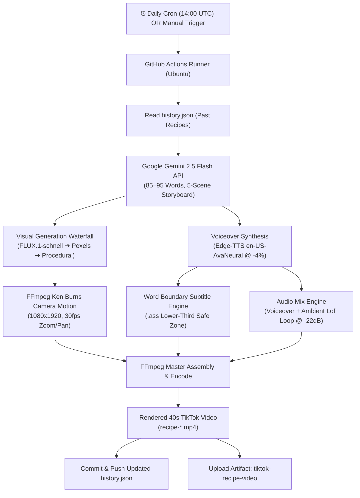

# 🎬 Autonomous 40s TikTok Video Generation Engine

A fully autonomous, scheduled 40-second TikTok video generation engine powered by **Google Gemini 2.5 Flash**, **Black Forest Labs FLUX.1-Schnell**, **Microsoft Edge-TTS**, and **FFmpeg** — running **100% in the cloud on GitHub Actions**.

---

## 🌟 Highlights

- **100% Autonomous Cloud Execution**: Runs entirely inside GitHub Actions (zero setup or background tasks on your local PC).
- **Intelligent Storyboard Engine**: Uses `gemini-2.5-flash` to brainstorm viral, trending baking and comfort-food concepts or takes a custom topic on demand.
- **Strict 40-Second Timing Constraint**: Narration is strictly engineered to **85–95 words** total across exactly 5 scenes (38–40 seconds at natural conversational pacing).
- **Tasty & @sugarspiceddreams Aesthetic Continuity**: Consistent white marble countertops, warm studio window light, shallow depth of field ($f/1.8$), clear glass bowls, and vintage brass utensils across every scene.
- **Cinematic Ken Burns Motion**: Smooth $1080 \times 1920$ macro camera pans and slow zooms generated natively via FFmpeg `zoompan`.
- **Cozy Voiceover & Lower-Third Subtitles**: Edge-TTS `en-US-AvaNeural` at `-4%` speed with lower-third `.ass` subtitles timed to exact word boundaries (2–3 words per line, zero flicker).
- **Duplicate Prevention History**: Automatically updates and commits `history.json` back to your GitHub repository after every run.
- **Direct Video Artifacts**: Download the rendered 40s `.mp4` video (e.g. `recipe-brown-butter-cinnamon-rolls.mp4`) directly from the GitHub Actions run summary.

---

## 🏗️ Architecture Flow



---

## ⏱️ Storyboard Structure & Scene Breakdown

The script is strictly split into 5 sequential scenes (~7–8 seconds each):

| Scene # | Stage | Visual Focus | Pacing & Audio Script |
|---|---|---|---|
| **Scene 1** | **The Hook** | Macro cross-section / bite / gooey center reveal | Warm, captivating hook sentence |
| **Scene 2** | **Base Prep** | Whisking warm ingredients into a glossy ribbon | Rich ingredient blending & textures |
| **Scene 3** | **Dough / Mix-in** | Folding chunks, velvety ganache, or pouring sauces | Tactile folding & luscious mix-ins |
| **Scene 4** | **Cook / Bake** | Oven rise, bubbling golden crust, caramelization | Sizzle & thermal transformation |
| **Scene 5** | **Finishing & Plating**| Drizzle, flaky sea salt garnish, final aesthetic shot | Aesthetic presentation & call to action |

Total spoken word count is strictly **85 to 95 words** (~38 to 40 seconds spoken at `-4%` speed).

---

## 🔑 Setup & GitHub Secrets

To run this pipeline in your repository, add the following secrets to GitHub:

1. In your GitHub repository, go to **Settings** > **Secrets and variables** > **Actions**.
2. Click **New repository secret** and add:

| Secret Name | Required | Description |
|---|---|---|
| `GEMINI_API_KEY` | **Yes** | Your Google Gemini API Key ([Google AI Studio](https://aistudio.google.com/)). |
| `HF_TOKEN` | Recommended | Hugging Face Access Token with read access for `FLUX.1-schnell`. |
| `PEXELS_API_KEY` | Optional | Free Pexels API Key for portrait stock footage fallback. |

> [!IMPORTANT]
> Ensure your repository Actions permissions allow writes so the workflow can commit `history.json`:
> Go to **Settings** > **Actions** > **General** > **Workflow permissions** > Select **Read and write permissions**.

---

## 🚀 Running the Workflow

### 1. Automatic Daily Schedule
The workflow runs automatically every day at **14:00 UTC** (10:00 AM EDT / 7:00 AM PDT) via the cron trigger in `.github/workflows/generate_video.yml`:
```yaml
schedule:
  - cron: '0 14 * * *'
```

### 2. Manual Trigger (`workflow_dispatch`)
You can trigger a video generation anytime manually:
1. Go to the **Actions** tab in your repository.
2. Select **Autonomous TikTok Video Engine** from the left sidebar.
3. Click **Run workflow**.
4. *(Optional)* Enter a specific recipe in **Custom recipe topic** (e.g. `Molten Matcha Lava Cake`). Leave blank to let Gemini auto-pick a viral trend that has not been made before.
5. Click the green **Run workflow** button.

---

## 📥 Accessing Rendered Videos

Once a workflow run completes (typically in ~2–3 minutes):
1. Open the completed run under **Actions**.
2. Scroll down to the **Artifacts** section at the bottom.
3. Download `tiktok-recipe-video`.
4. Inside you will find the final rendered MP4 (e.g. `recipe-brown-butter-cinnamon-rolls.mp4`), ready to upload directly to TikTok, YouTube Shorts, or Instagram Reels.
